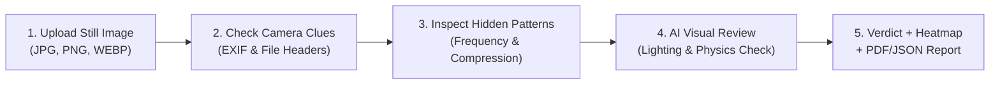
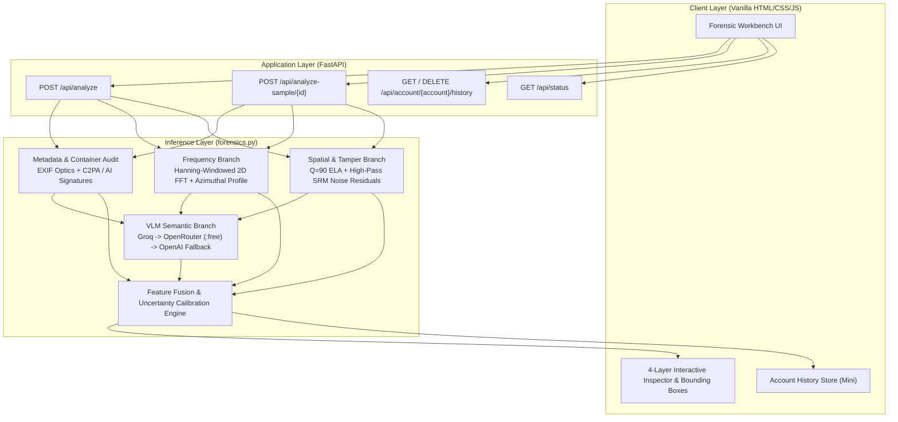
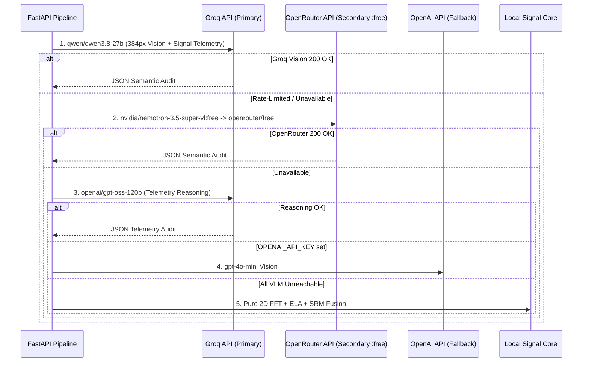

# VisionForensics-X

> **Look beyond the pixels.** An image-only digital forensics platform that tells you whether a photograph is **real**, **fully AI-generated**, or **partially edited/inpainted**—and shows *exactly where* and *why*.

---

## Part 1 — Plain-English Guide (No Technical Background Needed)

### What Is VisionForensics-X?
Modern AI tools (like Midjourney, Flux, DALL-E 3, and Stable Diffusion) can create hyper-realistic images or silently edit a single object inside a real photo. To the human eye, they look authentic.

**VisionForensics-X** acts like a digital microscope for still images (`JPG`, `PNG`, `WEBP`). You upload a photo, and within seconds it gives you:
1. **A Clear Verdict**: *Authentic Photograph*, *AI-Generated*, *AI-Edited / Manipulated*, or *Uncertain / Borderline*.
2. **A Visual Heatmap**: Highlights the exact region of the image that looks suspicious or edited.
3. **Plain-English Evidence**: Explains what clues were found (camera lens data, unnatural smoothness, hidden frequency patterns, or lighting inconsistencies).
4. **A Downloadable Report**: Export a clean PDF dossier or JSON record with one click.

### Who Is It For?
- **Journalists & Fact-Checkers** verifying breaking-news photos before publishing.
- **Investigators & Legal Teams** checking if an image was tampered with or spliced.
- **Everyday Users & Creators** wanting to know if an image online is genuine photography or synthetic AI art.

### How It Works (Step-by-Step)



### Understanding the 4 Visual Lenses
When you inspect an image in the workbench, you can switch between four different views:

| Lens | What It Shows in Plain English |
|---|---|
| **Original RGB** | Your uploaded photo exactly as it looks to the human eye. |
| **Grad-CAM / Noise Heatmap** | Warm glowing areas (orange/yellow) mark pixels that behave differently from the rest of the photo—great for spotting pasted objects or AI-inpainted regions. |
| **2D FFT Spectrum** | A mathematical "fingerprint" of repeating patterns. Real cameras produce organic, random grain; AI generators often leave faint grid dots or star-like spikes. |
| **ELA (Error Level Analysis)** | Resaves the image to see which parts compress differently. If someone pasted an object from another image, that patch lights up brighter than its surroundings. |

---

## Part 2 — Technical Architecture & Engineering Deep-Dive

### System Architecture

VisionForensics-X fuses **deterministic signal-processing forensics** with **multimodal Vision-Language Model (VLM) reasoning** inside a lightweight FastAPI + Vanilla JS application.



### Multi-Provider VLM Routing Cascade

The VLM branch dynamically reloads `.env` on every request and cascades through free-tier multimodal providers before falling back to local signal forensics:



### How Each Forensic Branch Works

1. **Preprocessing & Container Audit (`extract_metadata_forensics`)**
   - Extracts EXIF tags (`Make`, `Model`, `ExposureTime`, `FNumber`, `ISOSpeedRatings`, `FocalLength`) and PNG info chunks.
   - Scans headers for known generator/provenance markers (`Midjourney`, `Stable Diffusion`, `ComfyUI`, `Flux`, `DALL-E`, `C2PA`, `SynthID`).
2. **2D Frequency Branch (`analyze_frequency_branch`)**
   - Converts luminance to float32, applies a 2D Hanning window to suppress border spectral leakage, and computes `np.fft.fftshift(np.fft.fft2(...))`.
   - Measures mid-to-high-frequency periodic spike Z-scores (`spike_z`) and azimuthal radial energy roll-off (`hf_mid_ratio`), rendering a spectral colormap + 31-bin radial profile.
3. **Spatial & Localization Branch (`analyze_spatial_and_localization`)**
   - Computes **Error Level Analysis (ELA)** against a `Q=90` JPEG re-encode.
   - Extracts **high-pass noise residuals** via Gaussian blur subtraction and evaluates 16×16 block variance + median absolute deviation (MAD).
   - Blends normalized spatial anomalies into a thermal Grad-CAM style heatmap overlay and extracts top suspicious bounding boxes (`[x_pct, y_pct, w_pct, h_pct]`).
4. **Feature Fusion & Uncertainty Calibration (`analyze_image_pipeline`)**
   - Combines VLM semantic probabilities with spatial, frequency, and metadata scores.
   - Flags elevated uncertainty on low-resolution (`< 380px`) or heavily recompressed inputs so compressed social-media forwards are not misclassified with false certainty.

### Tech Stack

- **Backend**: Python, FastAPI, Uvicorn, HTTPX (async API client), Python-Dotenv
- **Image & Signal Processing**: Pillow (PIL), NumPy (2D FFT, MAD, radial spectrum binning)
- **Frontend**: Vanilla HTML5, Modern CSS3 (`<dialog closedby="any">`, `@starting-style`, `accent-color` with `@supports not` fallbacks), Vanilla ES6+ JavaScript, SVG radial charts
- **Deployment**: Vercel Serverless Python (`api/index.py` + `vercel.json`)

---

## Local Development Setup

```bash
# 1. Clone the repository
git clone https://github.com/SairajMN/VisionForensics-X.git
cd VisionForensics-X

# 2. Create virtual environment & install dependencies
python3 -m venv .venv
.venv/bin/pip install -r requirements.txt

# 3. Configure API keys (optional — local signal core works offline)
cp .env.example .env
# Add GROQ_API_KEY, OPENROUTER_API_KEY, and/or OPENAI_API_KEY in .env

# 4. Run the 10-image verification suite
.venv/bin/python test_forensics.py

# 5. Start the web server
.venv/bin/uvicorn app:app --reload --port 8000
```

Open **http://127.0.0.1:8000** in your browser.

---

## Deploying to Vercel (via GitHub)

This repository is pre-configured for one-click Vercel deployment via [vercel.json](vercel.json) and [api/index.py](api/index.py):

1. Push this repository to GitHub.
2. In the **Vercel Dashboard**, click **Add New → Project** and import `VisionForensics-X`.
3. Under **Environment Variables**, add any of:
   - `GROQ_API_KEY`
   - `OPENROUTER_API_KEY`
   - `OPENAI_API_KEY`
4. Click **Deploy**. Vercel automatically installs `requirements.txt`, routes all requests through `api/index.py`, serves the 10 calibrated sample images from `samples/`, and serves the pre-loaded `Mini` account history from `data/accounts/mini.json` (with `/tmp` write fallback for new uploads in serverless invocations).
